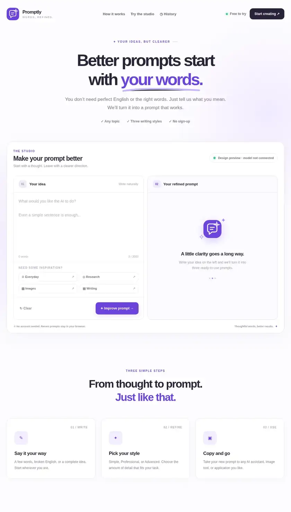

# Promptly

Write an idea in your own words. Promptly turns it into a clearer prompt for an AI tool.



The app gives you three versions of the same request:

- **Simple** — short and direct
- **Professional** — clear and polished
- **Advanced** — more detail where it helps

It works with everyday questions, writing, research, coding, and image prompts. The target AI setting adapts the wording of the prompts, **not the AI service used to generate them**. It keeps the original intent rather than adding unrelated instructions.

## What it does

- Improves rough or incomplete English
- Suggests three prompts to choose from
- One target AI dropdown: Universal, GPT, Claude, Gemini, DeepSeek, Qwen, Grok or Image AI
- Remembers the selected target in your browser, so you choose it only once
- Copies the result with one click
- Keeps recent prompts in your own browser
- Press Enter to improve, or Shift + Enter for a new line
- Works without sign-up or a database

## Run locally

Node.js 20 or newer:

```bash
npm install
cp .env.example .env.local
npm run dev
```

**OpenRouter setup (recommended):** create a key at https://openrouter.ai/settings/keys, then set `OPENROUTER_API_KEY` to the full key in Vercel Production environment variables. You may set `OPENROUTER_MODEL=openrouter/free`, but it is already the default. The app prefers OpenRouter whenever both providers are configured. Model IDs are restricted to `openrouter/free` or names ending in `:free`, so the app does not silently select paid OpenRouter models.

Redeploy Production after changing environment variables. Visit `/api/status` to confirm `"provider":"openrouter"` and `"model":"openrouter/free"`. Test with a short input. Free inference is rate-limited and may be slow or temporarily unavailable. The default integration makes one request with a 25-second timeout rather than stacking multiple slow fallbacks. The API key stays on the server; never share it or commit it.


## Stack

Next.js · TypeScript · OpenRouter / Gemini

MIT License.


If generation fails, check `/api/status` to confirm which provider and model the deployed app selected. Provider errors now include their HTTP status (such as 400 for an invalid request or 404 for an unavailable model). Detailed server-side codes are logged without secrets in Vercel Function Logs. Make sure Vercel's Production environment and redeployed version use the intended `GEMINI_MODEL`.

## Free-tier reliability

Promptly uses only `openrouter/free` or an explicitly selected model whose ID ends with `:free`. It never selects paid inference. The server makes at most one OpenRouter attempt per generation, with an 11-second timeout. When OpenRouter returns a rate limit, cannot respond, or a key is missing, Promptly automatically produces a clearly labelled **basic built-in draft** with Simple, Professional and Advanced variants. This fallback uses deterministic templates, not AI, and does not consume OpenRouter requests. A best-effort in-memory 429 cooldown reduces repeated requests within a serverless instance; it is not shared globally. The app also reuses recent successfully generated AI prompts when the exact input and target are repeated, reducing free quota use. For production-scale limits, use a distributed limiter.
